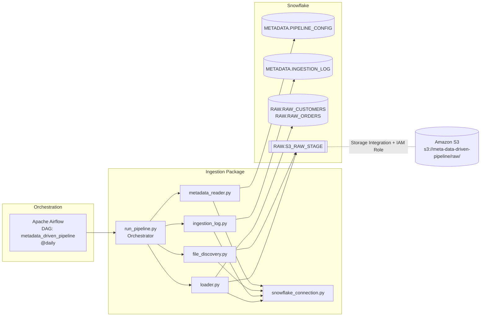

<div align="center">

# 🚀 META-DATA-DRIVEN-PIPELINE

### An enterprise-grade, metadata-driven data ingestion framework for Snowflake, AWS S3 and Apache Airflow


</div>

---

## 📑 Table of Contents

1. [Project Overview](#-project-overview)
2. [Core Features & Engineering Highlights](#-core-features--engineering-highlights)
3. [Architecture](#-architecture)
4. [Tech Stack](#-tech-stack)
5. [Project Structure](#-project-structure)
6. [Module Reference](#-module-reference)
7. [Detailed Workflow](#-detailed-workflow)
8. [Database & Infrastructure Setup](#-database--infrastructure-setup)
9. [Schema Definitions](#-schema-definitions)
10. [Onboarding a New Data Source](#-onboarding-a-new-data-source)
11. [Getting Started](#-getting-started)
12. [Observability: Querying the Audit Log](#-observability-querying-the-audit-log)
13. [Engineering Skills Demonstrated](#-engineering-skills-demonstrated)

---

## 📌 Project Overview

**META-DATA-DRIVEN-PIPELINE** is an enterprise-grade, **metadata-driven data ingestion framework**. Instead of writing a hardcoded script for every new data source, this pipeline **decouples pipeline logic from execution configuration**: the *what* (sources, paths, targets) lives in a Snowflake metadata table, and the *how* (discover, validate, load, log) lives in reusable Python modules.

**What it does:**

1. Dynamically reads **active** pipeline configurations from a Snowflake metadata table.
2. Discovers files on an **AWS S3 external stage**.
3. Checks historical logs to **prevent duplicate processing (idempotency)**.
4. **Bulk-loads** raw data into Snowflake using optimized `COPY INTO` commands.
5. Logs execution metrics and lineage for **complete observability**.
6. Runs automatically on a daily schedule via **Apache Airflow**.

---

## ✨ Core Features & Engineering Highlights

| Capability | Description |
|---|---|
| 🧩 **Metadata-Driven Architecture** | Onboarding a new data source or pipeline requires **zero code changes**, only an `INSERT` into the `PIPELINE_CONFIG` table. |
| ♻️ **Idempotency & Duplicate Prevention** | State-tracking through the `INGESTION_LOG` audit table. Before processing, the pipeline checks whether a source file has already reached `SUCCESS` status and safely skips duplicates. |
| 🔍 **Observability & Audit Logging** | End-to-end lineage via unique run IDs (`UUID`), file sizes, last-modified timestamps, start/end times, rows loaded, and precise error messages. |
| 🛡️ **Error Handling** | Execution is wrapped in a `try-except` block; both success and failure metrics (including error messages) are written back to `INGESTION_LOG`. |
| ☁️ **Secure Cloud Integration & Bulk Loading** | AWS S3 is connected to Snowflake through a **Storage Integration** and an **IAM role** (no embedded AWS keys), with high-performance bulk loading via `COPY INTO`. |
| 🔄 **Type Casting During Load** | Strings are cast to proper types on load (`TO_DATE`, `TO_TIMESTAMP_NTZ`, numerics), and each row is stamped with source file name and ingestion time. |
| ⏱️ **Workflow Orchestration** | Automated daily scheduling and execution management with Apache Airflow. |
| 🐳 **Containerized Infrastructure** | Docker & Docker Compose for reproducible local environments. |
| 📈 **Scalability by Design** | Config-per-source rows mean the same code scales horizontally across many sources, stages, and target tables. |

---

## 🏗️ Architecture



---

## 🧰 Tech Stack

| Layer | Technology |
|---|---|
| **Orchestration** | Apache Airflow (DAG: `metadata_driven_pipeline`) |
| **Data Warehouse** | Snowflake (Schemas: `RAW`, `METADATA`, `BRONZE`, `SILVER`, `GOLD`) |
| **Cloud Storage** | Amazon S3 (External Stage: `S3_RAW_STAGE`) |
| **Language** | Python (Snowflake Connector, `python-dotenv`, `uuid`, `datetime`) |
| **Infrastructure** | Docker & Docker Compose |

---

## 📂 Project Structure

```text
META-DATA-DRIVEN-PIPELINE/
├── .env                  # Environment variables (Snowflake credentials)
├── .gitignore            # Git ignore file
├── docker-compose.yml    # Docker services configuration
├── requirements.txt      # Python dependencies
├── airflow/
│   ├── config/           # Airflow configurations
│   ├── dags/
│   │   └── metadata_pipeline_dag.py  # Airflow DAG for orchestration
│   ├── logs/             # Execution and task logs
│   └── plugins/          # Custom Airflow plugins
├── data/
│   ├── customers.csv     # Sample customer source data
│   └── orders.csv        # Sample order source data
└── ingestion/            # Core ingestion package
    ├── __init__.py
    ├── config.py         # Config loader for Snowflake settings
    ├── file_discovery.py # S3 file listing and parsing
    ├── ingestion_log.py  # Audit logging and idempotency checks
    ├── loader.py         # Snowflake COPY INTO loading logic
    ├── metadata_reader.py# Active pipeline configurations reader
    ├── run_pipeline.py   # Orchestrator runner script
    └── snowflake_connection.py # Snowflake connection manager
```

---

## 🧱 Module Reference

| Module | Responsibility |
|---|---|
| `ingestion/config.py` | Loads Snowflake connection settings (via `python-dotenv` from `.env`). |
| `ingestion/snowflake_connection.py` | Snowflake connection manager used by all other modules. |
| `ingestion/metadata_reader.py` | Reads active pipeline configurations (`IS_ACTIVE = TRUE`) from `META_DATA_PIPELINE.METADATA.PIPELINE_CONFIG`. |
| `ingestion/file_discovery.py` | Runs Snowflake `LIST @stage/path` on the S3 external stage and parses each file's name, size, and last-modified timestamp. |
| `ingestion/ingestion_log.py` | Audit logging and idempotency checks, including `is_file_processed()`, which queries `INGESTION_LOG` for prior successful loads. |
| `ingestion/loader.py` | Builds and executes Snowflake `COPY INTO` commands with custom type casting and metadata columns. |
| `ingestion/run_pipeline.py` | Orchestrator runner: iterates pipelines and files, wraps execution in `try-except`, and records success/failure metrics. |
| `airflow/dags/metadata_pipeline_dag.py` | Airflow DAG `metadata_driven_pipeline`, scheduled `@daily`. |

---

## 🔄 Detailed Workflow

```text
 ┌──────────────────┐   ┌──────────────────┐   ┌──────────────────┐
 │ 1. Metadata Init │──▶│ 2. File Discovery│──▶│ 3. Idempotency   │
 └──────────────────┘   └──────────────────┘   │    Verification  │
                                               └────────┬─────────┘
                                                        │ not yet loaded
 ┌──────────────────┐   ┌──────────────────┐   ┌────────▼─────────┐
 │ 6. Orchestration │◀──│ 5. Audit Logging │◀──│ 4. Bulk Loading  │
 │    (Airflow)     │   │                  │   │   (COPY INTO)    │
 └──────────────────┘   └──────────────────┘   └──────────────────┘
```

1. **Metadata Initialization**: `metadata_reader.py` queries `META_DATA_PIPELINE.METADATA.PIPELINE_CONFIG` to fetch all active pipelines (`IS_ACTIVE = TRUE`).
2. **File Discovery**: `file_discovery.py` uses Snowflake's `LIST @stage/path` command on the S3 external stage to discover available files, parsing their sizes and modification timestamps.
3. **Idempotency Verification**: `ingestion_log.py` queries `INGESTION_LOG` via `is_file_processed()` to see whether the file was already successfully loaded. If yes, execution skips it with a log message.
4. **Bulk Data Loading**: `loader.py` triggers Snowflake `COPY INTO` commands. It handles custom type casting (for example, strings to dates with `TO_DATE($6, 'DD-MM-YYYY')`, timestamps with `TO_TIMESTAMP_NTZ`, and numbers), and captures `METADATA$FILENAME` and `CURRENT_TIMESTAMP()` for lineage columns.
5. **Audit Logging**: `run_pipeline.py` wraps execution in a `try-except` block, recording success/failure metrics, row counts, and error messages back to `INGESTION_LOG`.
6. **Orchestration**: `metadata_pipeline_dag.py` schedules this process daily (`@daily`) in Apache Airflow.

---

## 🗄️ Database & Infrastructure Setup

Run the following in Snowflake. Objects are listed in a logical order: database and schemas first, then S3 connectivity, then tables and seed metadata.

### 1. Database & Schemas

```sql
CREATE DATABASE IF NOT EXISTS META_DATA_PIPELINE;
CREATE SCHEMA IF NOT EXISTS META_DATA_PIPELINE.RAW;
CREATE SCHEMA IF NOT EXISTS META_DATA_PIPELINE.METADATA;
CREATE SCHEMA IF NOT EXISTS META_DATA_PIPELINE.BRONZE;
CREATE SCHEMA IF NOT EXISTS META_DATA_PIPELINE.SILVER;
CREATE SCHEMA IF NOT EXISTS META_DATA_PIPELINE.GOLD;
```

### 2. S3 Storage Integration, External Stage & File Format

```sql
CREATE OR REPLACE STORAGE INTEGRATION META_DATA_S3_INTEGRATION
  TYPE = EXTERNAL_STAGE
  STORAGE_PROVIDER = 'S3'
  ENABLED = TRUE
  STORAGE_AWS_ROLE_ARN = 'arn:aws:iam::<YOUR_AWS_ACCOUNT_ID>:role/meta-data-role'
  STORAGE_ALLOWED_LOCATIONS = ('s3://meta-data-driven-pipeline/raw/');

CREATE OR REPLACE STAGE META_DATA_PIPELINE.RAW.S3_RAW_STAGE
  URL = 's3://meta-data-driven-pipeline/raw/'
  STORAGE_INTEGRATION = META_DATA_S3_INTEGRATION;

CREATE OR REPLACE FILE FORMAT CSV_FORMAT
  TYPE = CSV
  SKIP_HEADER = 1
  FIELD_OPTIONALLY_ENCLOSED_BY = '"'
  TRIM_SPACE = TRUE
  EMPTY_FIELD_AS_NULL = TRUE
  NULL_IF = ('NULL', 'null', '');
```

> 🔐 **Security note:** Access to S3 is granted through a Snowflake **Storage Integration** that assumes an **AWS IAM role**, so no long-lived AWS access keys are stored in code or config. Replace `<YOUR_AWS_ACCOUNT_ID>` with your own account ID and complete the IAM trust relationship using the values from `DESC INTEGRATION META_DATA_S3_INTEGRATION;`.

### 3. RAW Layer Tables

```sql
USE DATABASE META_DATA_PIPELINE;
USE SCHEMA RAW;

CREATE OR REPLACE TABLE RAW_CUSTOMERS (
    CUSTOMER_ID       VARCHAR,
    FIRST_NAME        VARCHAR,
    LAST_NAME         VARCHAR,
    EMAIL             VARCHAR,
    CITY              VARCHAR,
    REGISTRATION_DATE DATE,
    UPDATED_AT        TIMESTAMP_NTZ,
    INGESTED_AT       TIMESTAMP_NTZ,
    SOURCE_FILE       VARCHAR
);

CREATE OR REPLACE TABLE RAW_ORDERS (
    ORDER_ID      VARCHAR,
    CUSTOMER_ID   VARCHAR,
    ORDER_DATE    DATE,
    PRODUCT_NAME  VARCHAR,
    CATEGORY      VARCHAR,
    QUANTITY      NUMBER,
    UNIT_PRICE    NUMBER(12,2),
    ORDER_AMOUNT  NUMBER(14,2),
    ORDER_STATUS  VARCHAR,
    UPDATED_AT    TIMESTAMP_NTZ,
    INGESTED_AT   TIMESTAMP_NTZ,
    SOURCE_FILE   VARCHAR
);
```

### 4. METADATA Layer Tables

```sql
USE DATABASE META_DATA_PIPELINE;
USE SCHEMA METADATA;

CREATE OR REPLACE TABLE PIPELINE_CONFIG (
    PIPELINE_ID     NUMBER AUTOINCREMENT,
    PIPELINE_NAME   VARCHAR NOT NULL,
    SOURCE_TYPE     VARCHAR NOT NULL,
    SOURCE_PATH     VARCHAR NOT NULL,
    FILE_PATTERN    VARCHAR,
    STAGE_NAME      VARCHAR NOT NULL,
    TARGET_DATABASE VARCHAR NOT NULL,
    TARGET_SCHEMA   VARCHAR NOT NULL,
    TARGET_TABLE    VARCHAR NOT NULL,
    LOAD_TYPE       VARCHAR NOT NULL,
    IS_ACTIVE       BOOLEAN DEFAULT TRUE,
    CREATED_AT      TIMESTAMP_NTZ DEFAULT CURRENT_TIMESTAMP(),
    CONSTRAINT PK_PIPELINE_CONFIG PRIMARY KEY (PIPELINE_ID)
);

CREATE OR REPLACE TABLE INGESTION_LOG (
    RUN_ID             VARCHAR NOT NULL,
    PIPELINE_ID        NUMBER NOT NULL,
    SOURCE_FILE        VARCHAR NOT NULL,
    FILE_SIZE          NUMBER,
    FILE_LAST_MODIFIED TIMESTAMP_TZ,
    STATUS             VARCHAR NOT NULL,
    ROWS_LOADED        NUMBER,
    START_TIME         TIMESTAMP_NTZ,
    END_TIME           TIMESTAMP_NTZ,
    ERROR_MESSAGE      VARCHAR,
    CREATED_AT         TIMESTAMP_NTZ DEFAULT CURRENT_TIMESTAMP()
);
```

### 5. Seed Pipeline Configuration

```sql
INSERT INTO PIPELINE_CONFIG
  (PIPELINE_NAME, SOURCE_TYPE, SOURCE_PATH, FILE_PATTERN, STAGE_NAME,
   TARGET_DATABASE, TARGET_SCHEMA, TARGET_TABLE, LOAD_TYPE, IS_ACTIVE)
VALUES
  ('customers_ingestion', 'S3', 'customers/', '.*\.csv',
   'META_DATA_PIPELINE.RAW.S3_RAW_STAGE', 'META_DATA_PIPELINE', 'RAW', 'RAW_CUSTOMERS', 'FULL', TRUE),
  ('orders_ingestion', 'S3', 'orders/', '.*\.csv',
   'META_DATA_PIPELINE.RAW.S3_RAW_STAGE', 'META_DATA_PIPELINE', 'RAW', 'RAW_ORDERS', 'FULL', TRUE);
```

> The `BRONZE`, `SILVER`, and `GOLD` schemas are provisioned for the downstream medallion layers. The ingestion framework in this repository populates the `RAW` layer.

---

## 📐 Schema Definitions

### `METADATA.PIPELINE_CONFIG`: the control plane

| Column | Type | Purpose |
|---|---|---|
| `PIPELINE_ID` | `NUMBER AUTOINCREMENT` (PK) | Unique pipeline identifier |
| `PIPELINE_NAME` | `VARCHAR NOT NULL` | Human-readable pipeline name |
| `SOURCE_TYPE` | `VARCHAR NOT NULL` | Source system type (e.g. `S3`) |
| `SOURCE_PATH` | `VARCHAR NOT NULL` | Path/prefix under the stage (e.g. `customers/`) |
| `FILE_PATTERN` | `VARCHAR` | Regex used to match files (e.g. `.*\.csv`) |
| `STAGE_NAME` | `VARCHAR NOT NULL` | Fully qualified Snowflake stage |
| `TARGET_DATABASE` / `TARGET_SCHEMA` / `TARGET_TABLE` | `VARCHAR NOT NULL` | Load destination |
| `LOAD_TYPE` | `VARCHAR NOT NULL` | Load strategy (seeded as `FULL`) |
| `IS_ACTIVE` | `BOOLEAN DEFAULT TRUE` | Toggle a pipeline on/off without code changes |
| `CREATED_AT` | `TIMESTAMP_NTZ` | Row creation time |

### `METADATA.INGESTION_LOG`: the audit & state-tracking table

| Column | Type | Purpose |
|---|---|---|
| `RUN_ID` | `VARCHAR NOT NULL` | UUID identifying a pipeline run (lineage) |
| `PIPELINE_ID` | `NUMBER NOT NULL` | Links to `PIPELINE_CONFIG` |
| `SOURCE_FILE` | `VARCHAR NOT NULL` | File that was processed |
| `FILE_SIZE` | `NUMBER` | Size of the file discovered on the stage |
| `FILE_LAST_MODIFIED` | `TIMESTAMP_TZ` | Last-modified timestamp of the file |
| `STATUS` | `VARCHAR NOT NULL` | Run status (`SUCCESS` is checked for idempotency) |
| `ROWS_LOADED` | `NUMBER` | Rows loaded by `COPY INTO` |
| `START_TIME` / `END_TIME` | `TIMESTAMP_NTZ` | Execution window |
| `ERROR_MESSAGE` | `VARCHAR` | Captured error text on failure |
| `CREATED_AT` | `TIMESTAMP_NTZ` | Log row creation time |

### `RAW` target tables

| Table | Business Columns | Lineage Columns |
|---|---|---|
| `RAW_CUSTOMERS` | `CUSTOMER_ID`, `FIRST_NAME`, `LAST_NAME`, `EMAIL`, `CITY`, `REGISTRATION_DATE` (DATE), `UPDATED_AT` (TIMESTAMP_NTZ) | `INGESTED_AT`, `SOURCE_FILE` |
| `RAW_ORDERS` | `ORDER_ID`, `CUSTOMER_ID`, `ORDER_DATE` (DATE), `PRODUCT_NAME`, `CATEGORY`, `QUANTITY` (NUMBER), `UNIT_PRICE` (NUMBER(12,2)), `ORDER_AMOUNT` (NUMBER(14,2)), `ORDER_STATUS`, `UPDATED_AT` (TIMESTAMP_NTZ) | `INGESTED_AT`, `SOURCE_FILE` |

---

## ➕ Onboarding a New Data Source

Because the framework is metadata-driven, adding a source is a **configuration change, not a code change**:

```sql
INSERT INTO META_DATA_PIPELINE.METADATA.PIPELINE_CONFIG
  (PIPELINE_NAME, SOURCE_TYPE, SOURCE_PATH, FILE_PATTERN, STAGE_NAME,
   TARGET_DATABASE, TARGET_SCHEMA, TARGET_TABLE, LOAD_TYPE, IS_ACTIVE)
VALUES
  ('<new_pipeline_name>', 'S3', '<prefix>/', '.*\.csv',
   'META_DATA_PIPELINE.RAW.S3_RAW_STAGE', 'META_DATA_PIPELINE', 'RAW', '<TARGET_TABLE>', 'FULL', TRUE);
```

To pause a pipeline without deleting it:

```sql
UPDATE META_DATA_PIPELINE.METADATA.PIPELINE_CONFIG
SET IS_ACTIVE = FALSE
WHERE PIPELINE_NAME = '<pipeline_name>';
```

> Note: the target table must exist, and the column casting performed by `loader.py` must match its structure.

---

## ⚙️ Getting Started

### Prerequisites

- Docker & Docker Compose
- A Snowflake account with privileges to create databases, schemas, storage integrations, and stages
- An AWS S3 bucket and IAM role configured for the Snowflake storage integration

### 1. Clone the repository

```bash
git clone <your-repository-url>
cd META-DATA-DRIVEN-PIPELINE
```

### 2. Configure environment variables

Create a `.env` file in the project root with your Snowflake credentials (loaded by `ingestion/config.py` via `python-dotenv`). The exact variable names are defined in `config.py`.

> ⚠️ `.env` holds secrets. It is listed for exclusion via `.gitignore`; never commit credentials.

### 3. Provision Snowflake objects

Execute the SQL from [Database & Infrastructure Setup](#-database--infrastructure-setup) in your Snowflake account.

### 4. Upload source files to S3

Upload the CSVs from `data/` to the staged S3 locations that match the configured `SOURCE_PATH` values:

```text
s3://meta-data-driven-pipeline/raw/customers/customers.csv
s3://meta-data-driven-pipeline/raw/orders/orders.csv
```

### 5. Start the stack

```bash
docker-compose up -d
```

Open the Airflow UI, enable the **`metadata_driven_pipeline`** DAG, and trigger it manually or let the `@daily` schedule run it.

### 6. (Optional) Run without Airflow

```bash
pip install -r requirements.txt
python -m ingestion.run_pipeline
```

---

## 🔎 Observability: Querying the Audit Log

Latest runs:

```sql
SELECT RUN_ID, PIPELINE_ID, SOURCE_FILE, STATUS, ROWS_LOADED, START_TIME, END_TIME, ERROR_MESSAGE
FROM META_DATA_PIPELINE.METADATA.INGESTION_LOG
ORDER BY CREATED_AT DESC;
```

Failures with error details:

```sql
SELECT RUN_ID, SOURCE_FILE, ERROR_MESSAGE, START_TIME
FROM META_DATA_PIPELINE.METADATA.INGESTION_LOG
WHERE STATUS <> 'SUCCESS'
ORDER BY CREATED_AT DESC;
```

Trace a loaded row back to its file and run via the `SOURCE_FILE` and `INGESTED_AT` columns on the RAW tables, joined to `INGESTION_LOG` on `SOURCE_FILE`.

---

## 🎯 Engineering Skills Demonstrated

- **Metadata-driven architecture**: configuration-as-data, zero-code onboarding
- **Idempotent data pipelines**: state-tracking via an audit table, safe re-runs
- **Audit logging & data lineage**: UUID run IDs, file-level metrics, row counts, error capture
- **Error handling**: structured `try-except` with failure persistence
- **Cloud data engineering**: Snowflake + AWS S3 with Storage Integrations and IAM roles
- **Bulk loading & type casting**: optimized `COPY INTO` with in-flight transformations
- **Workflow orchestration**: scheduled DAGs with Apache Airflow
- **Scalability**: one codebase, many sources, driven entirely by `PIPELINE_CONFIG`
- **Containerization**: reproducible environments with Docker Compose
- **Modular Python design**: single-responsibility modules for config, connection, discovery, logging, loading, and orchestration

---

<div align="center">

⭐ If you find this project useful, consider giving it a star!

</div>
